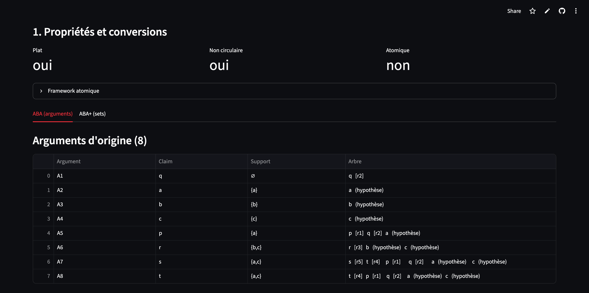
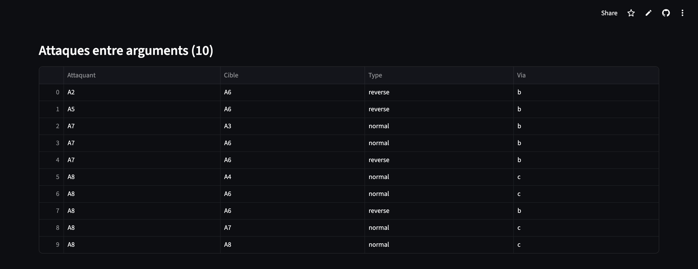
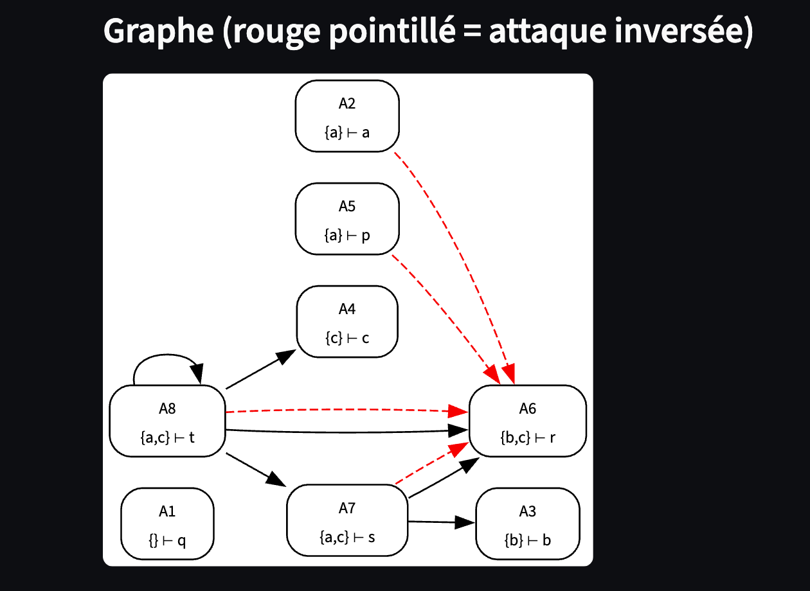
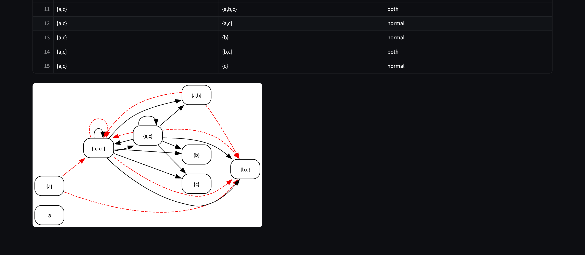

# Part 1 - Reasoning with ABA and ABA+

## Question 1.1 - ABA generator (4 marks)

### Aim and implementation map

The aim of this part is to build an ABA generator that reads a textual framework, performs the required transformations, constructs the finite core of arguments, computes attacks, and supports preferences. The implementation is organized around `ABAFramework` in `aba.py`. The following table maps each required capability to its implementation and executable evidence.

| Required capability | Code method | Evidence |
|---|---|---|
| Define literals, rules, and assumptions | `from_text()`, `Rule`, `ABAFramework` | Notebook sections 1-2; parser tests in `test_aba.py` |
| Define contraries for assumptions | `from_text()`, `validate()` | `C(a): r` parsing; validation tests |
| Convert to non-circular and atomic frameworks | `to_non_circular()`, `to_atomic()`, `prepare()` | Notebook section 6; TD4 Exercise 2 tests |
| Create all core arguments and attacks | `_raw_arguments()`, `arguments()`, `attacks()` | Notebook sections 3-4; TD4 Exercise 1 tests |
| Handle preferences and normal/reverse attacks | `_geq()`, `strictly_preferred()`, `less()`, `set_attacks()` | Notebook section 7; TD4 Exercise 3 tests |

The tests check not only totals but also the exact non-circular rule list and the exact pairs of ABA+ attacks. Running `python -m pytest -q test_aba.py` gives eight passing tests.

### ABA framework and input format

Following course 4A.1, an ABA framework is a tuple $(L,R,A,\overline{\cdot})$, where $L$ is a language of literals, $R$ is a set of rules, $A\subseteq L$ is a non-empty set of assumptions, and $\overline{\cdot}:A\to L$ is a total contrary function. A contrary is not required to be symmetric or bijective. It is the literal that can attack the corresponding assumption.

The parser accepts the format required by the assignment:

```text
## Literals
L: [a,b,c,q,p,r,s,t]

## Assumptions
A: [a,b,c]

## Contraries
C(a): r
C(b): s
C(c): t

## Rules
[r1]: p <- q,a
[r2]: q <-
[r3]: r <- b,c
[r4]: t <- p,c
[r5]: s <- t

## Preferences
PREF: a > b
```

A rule has the form $h\leftarrow b_1,\ldots,b_n$, and a rule with an empty body is a fact. In the course notation, the derivation of a fact has the single leaf $\tau$; in our trees $\tau$ is left implicit, so a fact node has no children. The `Rule` class stores the identifier, head, and body. `from_text()` parses literals, assumptions, contraries, rules, and preferences, while `validate()` checks that every assumption has a contrary, that every contrary is attached to an assumption, that preferences only mention assumptions, and that rule identifiers are unique.

### Deductions, arguments, and the core

A deduction is a tree whose root is a claim, whose leaves are assumptions or the fact leaf $\tau$, and whose internal nodes are justified by rules. An argument $X\vdash\sigma$ is a deduction with claim $\sigma$ whose assumption leaves form $X\subseteq A$. The `Argument` class stores an identifier, the claim, the support, and one derivation tree, which `tree_str()` displays in the notebook and the application.

`_raw_arguments()` starts from the arguments $\{a\}\vdash a$ and repeatedly applies every rule whose body has already been derived. It always terminates because the support-claim pairs are finite: a flat framework has at most

$$
2^{|A|}\,|L\setminus A|+|A|
$$

such pairs (course 4A.4). These pairs form the core $\{(leaves(t),cl(t))\}$ of the framework. Rules such as $x\leftarrow x$ produce infinitely many trees, but no new support-claim pair. `arguments()` therefore computes the core directly on the input framework, even when it is circular; the non-circular transformation is not needed for this step.

Credulous reasoning on the induced frameworks is NP-complete, and so is deciding whether a pair $(X,s)$ has a deduction (course 4A.4). Arguments whose support strictly contains another support with the same claim are redundant for ordinary ABA extensions, but they are kept here because ABA+ reverse attacks depend on every support. For example, with $z\leftarrow b$, $z\leftarrow b,w$, $z=\overline{x}$, and $w<x$, only the support $\{b,w\}$ yields the reverse attack from $\{x\}$ to $\{b,w\}$.

### Attacks between arguments

At the argument level, $A_1\vdash\sigma_1$ attacks $A_2\vdash\sigma_2$ if some $a\in A_2$ satisfies $\overline{a}=\sigma_1$ (undermining). `attacks()` builds this relation for the Dung-style graph of the application; with preferences, it only offers a complementary argument-level view, because the ABA+ relation of course 4B is defined between sets of assumptions and is computed by `set_attacks()`. The generator computes arguments and attacks, not extensions. Extensions can be obtained either on the induced Dung framework or directly on sets of assumptions, and the ABA correspondence theorem relates the two routes for admissible, complete, preferred, and stable extensions (course 4A.2).

### Non-circular transformation

The course defines a circular argument as a tree containing the same label twice on a root-to-leaf path. The implementation detects a syntactic cycle in the dependency graph of non-assumption literals with `find_cycle()` and `is_circular()`. This is a deliberate approximation: for example, the rules $p\leftarrow q$ and $q\leftarrow p$ are flagged as cyclic even though no argument for $p$ or $q$ can be built. The transformation remains correct in that case, because the course theorem holds for every ABA framework; it is simply applied when it is not strictly necessary.

For $X=L\setminus A$ and $k=|X|$, `to_non_circular()` creates levels $s_1,\ldots,s_{k-1}$ for each $s\in X$, while level $k$ keeps the original name $s$. Assumptions are never renamed. An atomic rule is copied at levels $1$ to $k$ with the same body. A non-atomic rule is copied at levels $2$ to $k$ and reads non-assumption body literals from level $i-1$. No artificial copy rules are added and the contrary mapping remains unchanged.

This transformation is not used to compute the original core: it establishes the non-circular precondition of the sensitive transformation. Since a non-redundant argument has depth at most $|L\setminus A|$, $k$ levels are sufficient, and the course theorem guarantees that the admissible, complete, preferred, grounded, and stable assumption sets are preserved. On the TD4 Exercise 2 framework, it produces 12 rules, 10 arguments, and 12 attacks.

### Sensitive atomic transformation

A framework is atomic if every rule body is a subset of the assumptions. `to_atomic()` implements the sensitive construction from course 4A.5 and Lehtonen et al. (2023). For every non-assumption literal $s\in L\setminus A$, it adds assumptions $s_d$ and $s_{nd}$ and contraries

$$
\overline{s_d}=s_{nd},\qquad \overline{s_{nd}}=s.
$$

In rule bodies, every non-assumption $b$ is replaced by $b_d$; original assumptions, rule identifiers, and rule heads are preserved. New assumptions are not included in the preference relation. The method assumes a non-circular input and does not check the additional condition that every non-assumption literal has an argument, as in the course correction. The extension correspondence is $E=E'\cap A$; equality of individual argument lists is not claimed.

The complete implementation pipeline is `prepare()`: syntactic flattening if needed, non-circular transformation, then sensitive atomic transformation. `to_flat()` is an additional normalization for input frameworks in which an assumption is the head of a rule. It is outside the core course construction and does not claim to preserve the semantics of non-flat ABA frameworks.

### ABA+ preferences and set attacks

An ABA+ framework adds a transitive preference relation $\leq$ on assumptions. Its strict part is $<$. The notation `a,b > c` means $a\sim b$ and $c<a$, $c<b$; chains such as `a > b > c` are also accepted. `_geq()` computes the transitive closure, and `strictly_preferred()` and `less()` query its strict part.

Formally (course 4B), for sets $X,Y\subseteq A$, $X$ has a **normal** attack on $Y$ if there is a deduction $t$ such that $leaves(t)\subseteq X$, $cl(t)=\overline{y}$ for some $y\in Y$, and no $x'\in leaves(t)$ satisfies $x'<y$. $X$ has a **reverse** attack on $Y$ if there is a deduction $t$ such that $leaves(t)\subseteq Y$, $cl(t)=\overline{x}$ for some $x\in X$, and some $y'\in leaves(t)$ satisfies $y'<x$: the attack of $Y$'s deduction on $x$ is then reversed into an attack of $X$ on $Y$.

`set_attacks()` generates the equivalent relation efficiently by expanding each support and target assumption to all relevant supersets. It returns separate normal and reverse sets, because one pair may occur in both categories. It enumerates $2^{|A|}$ subsets and rejects frameworks with more than ten assumptions. The interface keeps exact counters but shows at most 5,000 table rows.

The following excerpt shows the central preference decision:

```python
if any(lt(s, contrary_assumption) for s in argument.support):
    for X in subsets:
        if contrary_assumption in X:
            for Y in subsets:
                if argument.support <= Y:
                    reverse.add((X, Y))
else:
    for X in subsets:
        if argument.support <= X:
            for Y in subsets:
                if contrary_assumption in Y:
                    normal.add((X, Y))
```

Without preferences, ABA+ coincides with ABA and all attacks are normal. Under weak contraposition, the course guarantees preferred and complete sets, and every preferred set is complete. ABA+ reverses preference-sensitive attacks; ASPIC+ removes them instead.

### TD4 validation for Question 1.1

The expected values below come from the **official TD4 correction**, except where the table states that they were derived from a course definition or proposition. The tests verify exact rules and exact attack pairs, not only the totals.

| Case | Source of the expected values | Expected and observed result | Status |
|---|---|---|---|
| Exercise 1, original ABA | Official TD4 correction | 8 arguments, 10 attacks | PASS |
| Exercise 1, sensitive atomic | Course 4A.5 definition applied to the Exercise 1 framework (computed) | 13 assumptions, 5 rules, 18 arguments | PASS |
| Exercise 2, non-circular | Official TD4 correction | 12 rules, 10 arguments, 12 attacks | PASS |
| Exercise 2, atomic | Official TD4 correction (20 assumptions, 12 rules); course proposition $\lvert A'\rvert+\lvert R'\rvert$ (32 arguments) | 20 assumptions, 12 rules, 32 arguments | PASS |
| Exercise 3, ABA+ | Official TD4 correction | 12 normal and 8 reverse attacks | PASS |

The complete extensions reported for Exercise 1, namely $\emptyset$ and $\{b,c\}$, and the preferred/stable result $\{b,c\}$ come from the official TD4 correction, not from this generator, which does not implement extension semantics. Likewise, the result that preference `a > b` changes the preferred winner to $\{a\}$ is a TD4 correction result, not a computation performed by `aba.py`.

## Question 1.2 - Online application (2 marks)

### Application and detailed instructions

The Streamlit application is available at **https://grp1projet.streamlit.app/**. The public source repository is **https://github.com/nirdidev05/projetarg**.

To reproduce the demonstration:

1. Open the application and keep the preloaded framework, or paste a framework using the `L:`, `A:`, `C(...)`, rule, and `PREF:` format shown above.
2. Keep the checkbox **« Utiliser les préférences (attaques normales / inversées) »** enabled to reproduce the ABA+ result, or disable it to inspect ordinary ABA attacks.
3. Click the button **« Générer »**. The application displays whether the framework is flat, non-circular, and atomic.
4. Open **« Framework atomique »**. For the assignment example, it displays 13 assumptions, 5 rules, and the atomic argument count $|A'|+|R'|=18$.
5. In **« ABA (arguments) »**, inspect the original arguments, claims, supports, derivation trees, argument attacks, and Graphviz graph. If a syntactic cycle is detected, the non-circular framework and its arguments are also displayed.
6. In **« ABA+ (sets) »**, inspect the exact normal and reverse counters and the table with columns `X`, `Y`, and `Type`. For the assignment example, the counters are 12 normal and 8 reverse attacks. The graph is shown for at most four assumptions; for larger frameworks, the full counters remain available and the table is limited to the first 5,000 pairs.

### Screenshots

All figures were taken on the deployed application (https://grp1projet.streamlit.app/) with the assignment example. The interface labels are in French.


*Figure 1. Input area with the assignment framework, the preference checkbox, and the « Générer » button.*



*Figure 2. Framework properties (flat, non-circular, not atomic) and the eight core arguments with their derivation trees.*



*Figure 3. The ten argument-level attacks, labelled normal or reverse, with the assumption reported in the `Via` column.*



*Figure 4. Argument-level graph: black arrows are normal attacks, red dashed arrows are reverse attacks.*


*Figure 5. ABA+ set view: 12 normal and 8 reverse attacks between sets of assumptions, followed by the beginning of the attack table. A pair counted in both categories is labelled `both`, so the 20 attacks occupy 16 rows.*



*Figure 6. End of the ABA+ attack table and graph of the attacks between sets of assumptions: black arrows are normal attacks, red dashed arrows are reverse attacks.*

### Reproducibility, source code, and limitations

The repository contains `aba.py`, `app.py`, `test_aba.py`, `make_nb.py`, and `part1_aba.ipynb`. The notebook keeps its outputs and contains the TD4 demonstrations. The runtime dependencies for deployment are listed in `requirements.txt`. To reproduce the tests and notebook locally, install the additional development tools with:

```bash
pip install -r requirements.txt
pip install pytest nbformat nbconvert ipykernel
python -m pytest -q test_aba.py
jupyter nbconvert --to notebook --execute --inplace part1_aba.ipynb
```

The ABA engine was written for this project. No external implementation was copied into it. The implementation is based on the definitions in the courses and the sources listed below; the report and notebook identify the transformations and their assumptions.

The main limitations are:

- the set-level ABA+ relation is exponential in the number of assumptions, hence the ten-assumption guard;
- the fixed-point argument construction can become expensive as supports and derivation combinations grow;
- contradictory preference declarations such as `PREF: a > b` and `PREF: b > a` cancel in the current transitive-closure representation without a warning;
- `to_atomic()` assumes a non-circular framework and does not verify that every non-assumption literal has an argument;
- `to_flat()` is an extra syntactic normalization and does not claim to preserve the semantics of non-flat ABA;
- `find_cycle()` detects syntactic cycles in the rule dependency graph, which can over-approximate circular arguments;
- the generator computes arguments and attacks, but not Dung or ABA+ extensions. Extension statements in this report are explicitly attributed to the official TD4 correction.

## References

- P. M. Dung. *On the Acceptability of Arguments and Its Fundamental Role in Nonmonotonic Reasoning, Logic Programming and n-Person Games*. Artificial Intelligence 77(2), 1995.
- P. M. Dung, R. A. Kowalski, and F. Toni. *Assumption-Based Argumentation*. In I. Rahwan and G. R. Simari (eds.), *Argumentation in Artificial Intelligence*, Springer, 2009.
- F. Toni. *A Tutorial on Assumption-Based Argumentation*. Argument & Computation 5(1), 2014.
- K. Čyras and F. Toni. *ABA+: Assumption-Based Argumentation with Preferences*. In *Proceedings of the 15th International Conference on Principles of Knowledge Representation and Reasoning (KR)*, 2016, pp. 553-556.
- T. Lehtonen, A. Rapberger, M. Ulbricht, and J. P. Wallner. *Argumentation Frameworks Induced by Assumption-Based Argumentation: Relating Size and Complexity*. In *Proceedings of the 20th International Conference on Principles of Knowledge Representation and Reasoning (KR)*, 2023.
- B. Yun. INF2347M *Argumentation Theory and Applications*, Université Lyon 1, 2026: Lecture 4A (*Assumption-based argumentation and complexity*), Lecture 4B (*ABA+ and comparison to ASPIC+*), and TD4 with its official correction.
