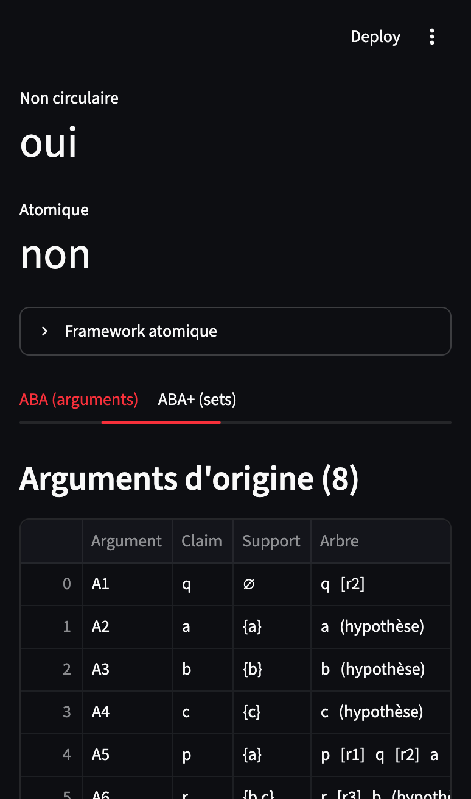
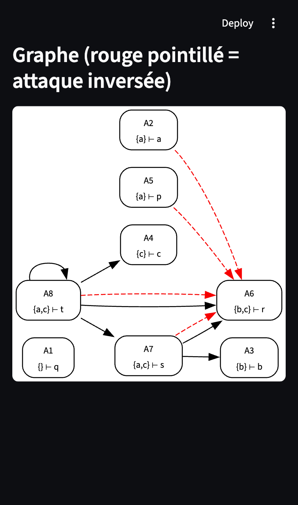
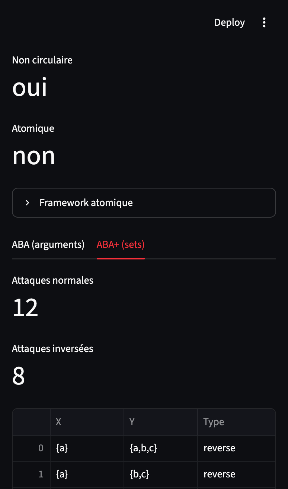

# Part 1 - Reasoning with ABA and ABA+

## Question 1.1 - ABA generator (4 marks)

### Aim and implementation map

The aim of this part is to build an ABA generator that reads a textual framework, performs the required transformations, constructs the finite core of arguments, computes attacks, and supports preferences. The implementation is organized around `ABAFramework` in `aba.py`. The following table maps each required capability to its implementation and executable evidence.

| Required capability | Code method | Evidence |
|---|---|---|
| Define literals, rules, and assumptions | `from_text()`, `Rule`, `ABAFramework` | Notebook cells 1-2; parser tests in `test_aba.py` |
| Define contraries for assumptions | `from_text()`, `validate()` | `C(a): r` parsing; validation tests |
| Convert to non-circular and atomic frameworks | `to_non_circular()`, `to_atomic()`, `prepare()` | Notebook cell 6; TD4 Exercise 2 tests |
| Create all core arguments and attacks | `_raw_arguments()`, `arguments()`, `attacks()` | Notebook cells 3-4; TD4 Exercise 1 tests |
| Handle preferences and normal/reverse attacks | `_geq()`, `strictly_preferred()`, `less()`, `set_attacks()` | Notebook cell 7; TD4 Exercise 3 tests |

The tests check not only totals but also the exact non-circular rule list and the exact pairs of ABA+ attacks. Running `python -m pytest -q test_aba.py` gives eight passing tests.

### ABA framework and input format

Following course 4A.1, an ABA framework is a tuple $(L,R,A,\overline{\cdot})$, where $L$ is a language of literals, $R$ is a set of rules, $A\subseteq L$ is a non-empty set of assumptions, and $\overline{\cdot}:A\to L$ is a total contrary function. A contrary is not required to be symmetric or bijective. It is the literal that can attack the corresponding assumption.

The parser accepts the format required by the assignment:

```text
## Literals
L: [a,b,c,q,p,r,s,t]

## Assumptions
A: [a,b,c]

## Contraries
C(a): r
C(b): s
C(c): t

## Rules
[r1]: p <- q,a
[r2]: q <-
[r3]: r <- b,c
[r4]: t <- p,c
[r5]: s <- t

## Preferences
PREF: a > b
```

A rule has the form $h\leftarrow b_1,\ldots,b_n$. A rule with an empty body is a fact. Its derivation has the single fact leaf $\tau$; it does not have an empty list of children. The `Rule` class stores the identifier, head, and body. `from_text()` parses literals, assumptions, contraries, rules, and preferences, while `validate()` checks that every assumption has a contrary, that every contrary is attached to an assumption, and that rule identifiers are unique.

### Deductions, arguments, and the core

A deduction is a tree whose root is a claim, whose leaves are assumptions or the special fact leaf $\tau$, and whose internal nodes are justified by rules. An argument is a deduction whose leaves are assumptions only. If the leaves are $X\subseteq A$ and the root is $\sigma$, the argument is written $X\vdash\sigma$. The `Argument` class stores the claim, support, identifier, and derivation tree; `tree_str()` exposes the tree to the notebook and application.

The method `_raw_arguments()` starts with the arguments supported by individual assumptions and repeatedly applies every rule whose body has already been derived. It stops because the pairs $(support,claim)$ are finite: there are at most

$$
2^{|A|}\,|L\setminus A|+|A|
$$

such pairs. This is the core of the framework, namely the set of pairs $(leaves(t),cl(t))$ for all deduction trees. The fixed point therefore terminates even when the set of full trees is infinite. For example, rules $x\leftarrow x$ and $y\leftarrow y$ can generate arbitrarily deep trees, but they cannot generate infinitely many distinct support-claim pairs.

`arguments()` computes this core directly on the original framework. This is important because the non-circular transformation is not needed to compute the original core; its role is to provide the precondition for the later sensitive atomic transformation. A non-redundant argument has depth at most $|L\setminus A|$, which motivates the level bound used by `to_non_circular()`.

The course also explains the computational difficulty: deciding whether a pair $(X,s)$ has a deduction is difficult, and credulous reasoning is NP-complete. Arguments with the same claim and a strict superset of another support can be redundant for ordinary ABA extensions. They are nevertheless retained here because all supports matter for ABA+ reverse attacks. For example, consider rules $z\leftarrow b$ and $z\leftarrow b,w$, with $z=\overline{x}$ and $w<x$. The support $\{b,w\}$ can generate the preference-sensitive reverse attack from $\{x\}$ to $\{b,w\}$; deleting that support would lose this attack.

### Attacks between arguments and ABA reasoning

At the argument level, $A_1\vdash\sigma_1$ attacks $A_2\vdash\sigma_2$ if some $a\in A_2$ satisfies $\overline{a}=\sigma_1$. This is the undermining relation. `attacks()` is a complementary argument-level view: it is useful for displaying a Dung-style graph, but the ABA+ definition used for the assessment is the set-level relation implemented by `set_attacks()`.

ABA supports two equivalent reasoning routes. In the abstract route, arguments and attacks form a Dung argumentation framework; one then applies complete, preferred, stable, grounded, or other semantics and collects the assumptions in accepted arguments. In the direct route, one reasons over sets of assumptions using conflict-freeness, defence, admissibility, completeness, preferredness, and stability. The ABA correspondence theorem relates these routes for admissible, complete, preferred, and stable extensions. The generator itself computes arguments and attacks; it does not implement a Dung semantics solver.

### Non-circular transformation

The course defines a circular argument as a tree containing the same label twice on a root-to-leaf path. The implementation detects a syntactic cycle in the dependency graph of non-assumption literals with `find_cycle()` and `is_circular()`. This is a deliberate implementation approximation: for example, a pair of rules $p\leftarrow q$ and $q\leftarrow p$ is flagged as cyclic even if no argument with a supported leaf can actually be built. The transformation is still correct when applied to such a framework, although it was not necessary for that particular derivation set.

For $X=L\setminus A$ and $k=|X|$, `to_non_circular()` creates levels $s_1,\ldots,s_{k-1}$ for each $s\in X$, while level $k$ keeps the original name $s$. Assumptions are never renamed. An atomic rule is copied at levels $1$ to $k$ with the same body. A non-atomic rule is copied at levels $2$ to $k$ and reads non-assumption body literals from level $i-1$. No artificial copy rules are added and the contrary mapping remains unchanged.

This transformation is not used to compute the original core. Its role is to establish the non-circular precondition required by the sensitive transformation. The course theorem states that the relevant admissible, complete, preferred, grounded, and stable extensions are preserved. In the TD4 Exercise 2 framework, it produces 12 rules, 10 arguments, and 12 attacks.

### Sensitive atomic transformation

A framework is atomic if every rule body is a subset of the assumptions. `to_atomic()` implements the sensitive construction from course 4A.5 and Lehtonen et al. (2023). For every non-assumption literal $s\in L\setminus A$, it adds assumptions $s_d$ and $s_{nd}$ and contraries

$$
\overline{s_d}=s_{nd},\qquad \overline{s_{nd}}=s.
$$

In rule bodies, every non-assumption $b$ is replaced by $b_d$; original assumptions, rule identifiers, and rule heads are preserved. New assumptions are not included in the preference relation. The method assumes a non-circular input and does not check the additional condition that every non-assumption literal has an argument, as in the course correction. The extension correspondence is $E=E'\cap A$; equality of individual argument lists is not claimed.

The complete implementation pipeline is `prepare()`: syntactic flattening if needed, non-circular transformation, then sensitive atomic transformation. `to_flat()` is an additional normalization for input frameworks in which an assumption is the head of a rule. It is outside the core course construction and does not claim to preserve the semantics of non-flat ABA frameworks.

### ABA+ preferences and set attacks

An ABA+ framework adds a transitive preference relation $\leq$ on assumptions. Its strict part is $<$. The notation `a,b > c` means $a\sim b$ and $c<a$, $c<b$; chains such as `a > b > c` are also accepted. `_geq()` computes the transitive closure, and `strictly_preferred()` and `less()` query its strict part.

Formally, for sets $X,Y\subseteq A$, a normal attack $X\rightsquigarrow Y$ exists if there is a deduction $t$ such that $leaves(t)\subseteq X$, $cl(t)=\overline{y}$ for some $y\in Y$, and no $x'\in leaves(t)$ satisfies $x'<y$. An inverted attack exists when there is a deduction with leaves contained in $Y$, claim $\overline{x}$ for some $x\in X$, and at least one leaf $y'<x$; the direction is then reversed.

`set_attacks()` generates the equivalent relation efficiently by expanding each support and target assumption to all relevant supersets. It returns separate normal and reverse sets, because one pair may occur in both categories. It enumerates $2^{|A|}$ subsets and rejects frameworks with more than ten assumptions. The interface keeps exact counters but shows at most 5,000 table rows.

The following excerpt shows the central preference decision:

```python
if any(lt(s, contrary_assumption) for s in argument.support):
    for X in subsets:
        if contrary_assumption in X:
            for Y in subsets:
                if argument.support <= Y:
                    reverse.add((X, Y))
else:
    for X in subsets:
        if argument.support <= X:
            for Y in subsets:
                if contrary_assumption in Y:
                    normal.add((X, Y))
```

Without preferences, ABA+ coincides with ABA and all attacks are normal. Under weak contraposition, the course guarantees preferred and complete sets, and every preferred set is complete. ABA+ reverses preference-sensitive attacks; ASPIC+ removes them instead.

### TD4 validation for Question 1.1

The following results are from the **official TD4 correction**, reproduced and checked by the executable tests and notebook. The tests verify exact rules and exact attack pairs, not only the totals.

| Case | Source | Expected and observed result | Status |
|---|---|---|---|
| Exercise 1, original ABA | Official TD4 correction | 8 arguments, 10 attacks | PASS |
| Exercise 1, sensitive atomic | Official TD4 correction | 13 assumptions, 5 rules, 18 arguments | PASS |
| Exercise 2, non-circular | Official TD4 correction | 12 rules, 10 arguments, 12 attacks | PASS |
| Exercise 2, atomic | Official TD4 correction | 20 assumptions, 12 rules, 32 arguments | PASS |
| Exercise 3, ABA+ | Official TD4 correction | 12 normal and 8 reverse attacks | PASS |

The complete extensions reported for Exercise 1, namely $\emptyset$ and $\{b,c\}$, and the preferred/stable result $\{b,c\}$ come from the official TD4 correction, not from this generator, which does not implement extension semantics. Likewise, the result that preference `a > b` changes the preferred winner to $\{a\}$ is a TD4 correction result, not a computation performed by `aba.py`.

## Question 1.2 - Online application (2 marks)

### Application and detailed instructions

The Streamlit application is available at **https://grp1projet.streamlit.app/**. The public source repository is **https://github.com/nirdidev05/projetarg**.

To reproduce the demonstration:

1. Open the application and keep the preloaded framework, or paste a framework using the `L:`, `A:`, `C(...)`, rule, and `PREF:` format shown above.
2. Keep the checkbox **« Utiliser les préférences (attaques normales / inversées) »** enabled to reproduce the ABA+ result, or disable it to inspect ordinary ABA attacks.
3. Click the button **« Générer »**. The application displays whether the framework is flat, non-circular, and atomic.
4. Open **« Framework atomique »**. For the assignment example, it displays 13 assumptions, 5 rules, and the atomic argument count $|A'|+|R'|=18$.
5. In **« ABA (arguments) »**, inspect the original arguments, claims, supports, derivation trees, argument attacks, and Graphviz graph. If a syntactic cycle is detected, the non-circular framework and its arguments are also displayed.
6. In **« ABA+ (sets) »**, inspect the exact normal and reverse counters and the table with columns `X`, `Y`, and `Type`. For the assignment example, the counters are 12 normal and 8 reverse attacks. The graph is shown for at most four assumptions; for larger frameworks, the full counters remain available and the table is limited to the first 5,000 couples.

### Screenshots

The following screenshots were captured from the running application with the assignment example.



*Figure 1. Application properties and the ABA argument view.*



*Figure 2. Argument-level ABA graph, with normal attacks in black and reverse attacks in red dashed lines.*



*Figure 3. ABA+ set-level counters and graph.*

### Reproducibility, source code, and limitations

The repository contains `aba.py`, `app.py`, `test_aba.py`, `make_nb.py`, and `part1_aba.ipynb`. The notebook keeps its outputs and contains the TD4 demonstrations. The runtime dependencies for deployment are listed in `requirements.txt`. To reproduce the tests and notebook locally, install the additional development tools with:

```bash
pip install -r requirements.txt
pip install pytest nbformat nbconvert ipykernel
python -m pytest -q test_aba.py
jupyter nbconvert --to notebook --execute --inplace part1_aba.ipynb
```

The ABA engine was written for this project. No external implementation was copied into it. The implementation is based on the definitions in the courses and the sources listed below; the report and notebook identify the transformations and their assumptions.

The main limitations are:

- the set-level ABA+ relation is exponential in the number of assumptions, hence the ten-assumption guard;
- the fixed-point argument construction can become expensive as supports and derivation combinations grow;
- contradictory preference declarations such as `PREF: a > b` and `PREF: b > a` cancel in the current transitive-closure representation without a warning;
- `to_atomic()` assumes a non-circular framework and does not verify that every non-assumption literal has an argument;
- `to_flat()` is an extra syntactic normalization and does not claim to preserve the semantics of non-flat ABA;
- `find_cycle()` detects syntactic cycles in the rule dependency graph, which can over-approximate circular arguments;
- the generator computes arguments and attacks, but not Dung or ABA+ extensions. Extension statements in this report are explicitly attributed to the official TD4 correction.

## References

- P. M. Dung. *On the Acceptability of Arguments and Its Fundamental Role in Nonmonotonic Reasoning, Logic Programming and n-Person Games*. Artificial Intelligence, 1995.
- P. M. Dung, R. A. Kowalski, and F. Toni. *Assumption-Based Argumentation*. In *Argumentation in Artificial Intelligence*, 2009/2010.
- A. Čyras and F. Toni. *ABA+: Assumption-Based Argumentation with Preferences*. In *Proceedings of the International Conference on Principles of Knowledge Representation and Reasoning*, 2016.
- T. Lehtonen et al. *Sensitive transformations for assumption-based argumentation*. 2023.
- INF2347M, Course 4A: Assumption-Based Argumentation, lectures 4A.1-4A.5 and TD4.
- INF2347M, Course 4B: ABA+ and preferences.
