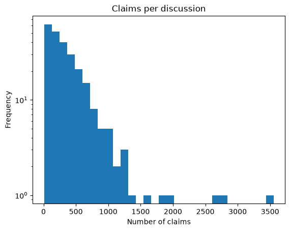
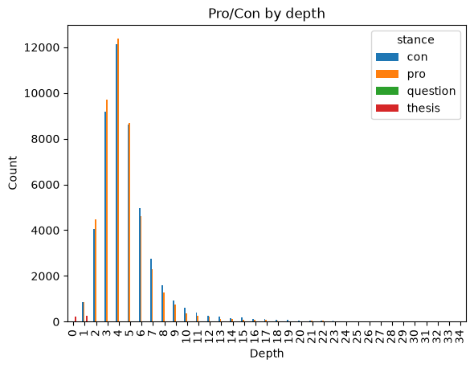

# Part 2 - Relation-based argument mining on Kialo

## Question 2.1 - Kialo collection and exploration (2 marks)

### Collection protocol

The corpus is a snapshot of the 250 highest-ranked public discussions returned by Kialo's discussion listing endpoint on 17 October 2026. The raw JSON response is saved in `data/kialo_listing_2026-10-17.json`. The notebook checks that it contains exactly 250 entries, that identifiers are unique, and that ranks are in descending order.

The content of each discussion comes from Kialo's official text export. Kialo's terms allow exports for private use, but its `robots.txt` disallows automated crawling (`User-agent: * Disallow: /`). For this reason, we did not use a scraper. A group member downloaded the 250 exports one by one from a logged-in account. Duplicate browser downloads were byte-identical and were removed, which leaves exactly one file per discussion (250/250). The automated download function in `part2_kialo.py` is kept for reproducibility but is disabled (`RUN_COLLECTION = False`), because it requires an authenticated session and Kialo's permission. The `data/` folder is not published in the public repository.

Our parser starts from the reference implementation (https://github.com/4mbroise/ADC, no licence). We modified it for the current export format:

| Export feature | Handling |
|---|---|
| Header line, then the title on line 2; nodes `1.2.3. Pro:` with the text on the following lines | Multi-line texts are joined until the next node or a blank line |
| Localized labels (`Pro`/`Pour`, `Con`/`Contra`/`Contre`, `Thesis`/`These`/`Tesis`/`Thèse`, `Question`/`Frage`) | Mapped to `pro`, `con`, `thesis`, `question` |
| Internal cross-links `-> See 1.4.2.` (5,504) | Removed, because they duplicate a node that already exists |
| External links `-> See discussion #N: text` (146) | Prefix removed, text kept, `N` stored in `external_discussion_id` |
| Citation markers `[n]`, including nested markers such as `[2 [900]]` | Removed (59,125 markers) |
| Sources section at the end of the file | Detected as a line ending with `:` that is followed by `[n]`, then ignored |
| 18 discussions whose root is a Question with several theses | The 258 Question→Thesis edges are excluded, because they are neither support nor attack. Edges towards each thesis are kept |

Validation: for all 250 discussions, the number of parsed claims equals the `claimAndThesisCount` value returned by the API. There are no parse failures and no empty texts.

### Corpus

The corpus contains 94,707 claims: 46,557 Pro, 47,642 Con, 490 theses and 18 questions. Each Pro or Con claim gives one labelled child→parent pair, for a total of 94,199 pairs: 46,557 `support` (49.4%) and 47,642 `attack` (50.6%). The listing contains 239 English discussions, 4 Spanish, 3 German, and one each in French, Swedish, Slovak and an unspecified language.

### Exploration

- **Size.** Discussion size is highly skewed (Figure 7). The median is 272.5 claims (interquartile range 128-484), the mean 378.8, and the maximum 3,554. Fourteen discussions have more than 1,000 claims.
- **Depth.** The median of the maximum depth per discussion is 7, and the deepest thread reaches depth 34. Pro/Con claims have a mean depth of 4.75, and most of them lie between depths 3 and 5.
- **Stance by depth.** Near the thesis, stances are balanced (50.3% Con at depth 1). Deeper down, attacks dominate: 54.8% Con at depth 7 and 61.7% at depth 10 or more (Figure 8). Deep threads are mostly chains of rebuttals, so depth carries a weak signal about the label.
- **Text.** Claims are short: the median is 22 words (140 characters), the 95th percentile is 50 words, and the longest claim has 117 words. A maximum length of 128 subword tokens is enough for transformer encoders.
- **Topics.** The discussions use 377 distinct tags. The most frequent are Politics (56 discussions), Ethics (44), Society (39), USA (31) and Philosophy (27).
- **Duplicates.** After normalization, 436 texts appear in more than one discussion. This is why we remove from the test set every pair whose text also appears in the training set (Question 2.2).
- **Activity.** The rank correlations (Spearman) between the number of claims and the number of views, votes and participants are 0.87, 0.80 and 0.76.

*Figure 7. Number of claims per discussion (logarithmic frequency scale).*

*Figure 8. Number of claims by depth and stance. Theses appear at depth 1 in the 18 discussions whose root is a Question.*

**Limitations.** The top-ranked discussions are not representative of Kialo as a whole (selection bias). The snapshot is dated. Pro/Con labels are chosen by users, and each label is relative to the parent claim only.

## Question 2.2 - Relation discovery and classification (5 marks)

### Tasks

- **Relation classification.** Given a linked child→parent pair, predict `support` (Pro) or `attack` (Con).
- **Relation discovery.** Given a claim, find its parent among the other claims of the same debate. We evaluate this task in two ways:
  - as a binary task (`linked` / `not_linked`);
  - as a ranking task, where every other claim of the debate is a candidate parent.

### Protocol

**Split.** Data are split **by debate**, never by pair, so that no topic appears in both training and test data. The split is 70/15/15 with seed 42: 175 training debates, 37 validation debates and 38 test debates. Classification and discovery use the same split. Because 436 texts are repeated across discussions, every test pair whose child or parent text appears in the training data is removed. This leaves 69,333 training pairs and 14,450 test pairs for classification (169 test pairs removed). No hyperparameter was tuned, so the validation debates are not used. The test set contains 34 English debates and 4 debates in other languages.

**Negative pairs for discovery.** Each positive pair (claim, true parent) is accompanied by three negatives, one per difficulty level:
- `cross_debate`: a claim from another debate;
- `same_debate`: a claim from the same debate that is neither the parent nor the grandparent;
- `local`: a sibling, the grandparent or a child of the claim.

The negatives are built **separately inside the training debates and inside the test debates**. A first version built them on the whole corpus before the split. As a result, `cross_debate` negatives of training debates drew 52.9% of the test claims into the training data. The overlap filter then deleted 77% of the discovery test set, which went from 14,619 to 3,317 positive pairs and was biased. After the correction, the discovery test set contains 14,450 `linked` pairs and 43,684 `not_linked` pairs (14,586 `local`, 14,552 `same_debate`, 14,546 `cross_debate`). The training set contains 69,333 positives and 69,614 negatives per level.

**Models.**

| Code | Model | Input |
|---|---|---|
| B0 | Majority class of the training set (`attack`) | none |
| B1 | TF-IDF (word 1-2-grams, sublinear tf) + logistic regression (balanced class weights) | `child: … parent: …` |
| B2 | Frozen Sentence-BERT (`all-MiniLM-L6-v2`) embeddings $u$ (child) and $v$ (parent), features $(u, v, \lvert u-v\rvert, u \odot v)$ + logistic regression | child and parent encoded separately |
| D1 | Discovery interaction model: TF-IDF cosine similarity, word Jaccard overlap, the two lengths and their difference + logistic regression (balanced) | pair |
| D2 | D1 + Jaccard overlap with the candidate's parent and the length of that context (a lightweight variant inspired by GraphNLI) | pair + context |

**Metrics.**
- **Classification**: the main metric is macro-F1. We also report per-class F1, accuracy (for comparison with GraphNLI), ROC-AUC and PR-AUC with `support` as the positive class, and the confusion matrix.
- **Binary discovery**: F1 of the `linked` class, macro-F1, ROC-AUC and PR-AUC with `linked` as the positive class.
- **Ranking**: Hits@1, Hits@5 and MRR over all candidates of the debate. When several candidates have the same score as the gold parent, we use the expected rank under a uniformly random tie-break. With $g$ candidates strictly above the gold parent and $t$ other candidates tied with it, $\text{Hits@}k = \min\big(1, \max(0, k-g)/(t+1)\big)$ and $\text{RR} = \frac{1}{t+1}\sum_{j=0}^{t}\frac{1}{g+1+j}$. A constant scorer therefore obtains exactly the chance level; this property is checked by a unit test.
- **Aggregation**: ranking is computed debate by debate to bound memory, and the per-debate scores are averaged with weights equal to the number of children scored.

### Relation classification results

| Model | Accuracy | Macro-F1 | F1 support | F1 attack | ROC-AUC | PR-AUC |
|---|---|---|---|---|---|---|
| Chance level | 0.504 | - | - | - | 0.500 | 0.496 |
| B0 majority | 0.504 | 0.335 | 0.000 | 0.670 | - | - |
| B1 TF-IDF + LR | 0.624 | 0.624 | 0.619 | 0.628 | 0.667 | 0.636 |
| B2 Sentence-BERT + LR | **0.649** | **0.649** | 0.650 | 0.649 | **0.709** | **0.688** |

Confusion matrices (rows: true attack, true support; columns: predicted attack, predicted support):
- B1 = [[4589, 2697], [2740, 4424]];
- B2 = [[4674, 2612], [2453, 4711]].

Both models handle the two classes evenly, and B2 improves every metric over B1, by +2.6 points of macro-F1 and +4.3 points of ROC-AUC. Semantic sentence embeddings capture stance better than word overlap. However, neither model encodes the two texts jointly, as a cross-encoder does, although stance depends on how the child relates to the parent.

### Relation discovery results

**Binary discovery** (test set: 14,450 `linked`, 43,684 `not_linked`):

| Model | Accuracy | Macro-F1 | F1 linked | F1 not_linked | ROC-AUC | PR-AUC |
|---|---|---|---|---|---|---|
| Always `not_linked` | 0.751 | 0.429 | 0.000 | 0.858 | 0.500 | 0.249 |
| D1 interaction | 0.747 | **0.691** | **0.559** | 0.822 | **0.778** | **0.525** |

Because of the 1:3 imbalance, accuracy is misleading: always answering `not_linked` gives a higher accuracy (0.751) than D1 (0.747). The informative metrics are macro-F1 (0.691 against 0.429), F1 of the `linked` class, and PR-AUC (0.525 against a chance level of 0.249). D1 recovers 64.7% of the true links (9,346 of 14,450).

**Ranking** over all candidates of the same debate (38 test debates, 14,619 children with a parent, 745.5 candidates per child on average):

| Model | Hits@1 | Hits@5 | MRR |
|---|---|---|---|
| Random ranking (expected value) | 0.0025 | 0.0127 | 0.0151 |
| D1 interaction | **0.127** | **0.289** | **0.210** |
| D2 interaction + context | 0.125 | 0.262 | 0.196 |

For each debate with $n$ candidates per child, the random baseline is $1/n$ for Hits@1, $\min(5,n)/n$ for Hits@5 and $H_n/n$ for MRR ($H_n$ is the $n$-th harmonic number). These values are weighted by the number of children, as in the notebook's per-debate table. D1 puts the true parent first for 12.7% of the claims, about 50 times the chance level, and in the top 5 for 28.9%. Adding the context of the candidate's parent (D2) does not improve ranking (Hits@5: 0.289 → 0.262). A plausible explanation is that, when a sibling of the claim is the candidate, its context is the claim's own parent, which overlaps strongly with the claim. The context feature then favours siblings over the true parent.

### Comparison with the literature

| Work | Data and protocol | Task | Result | Ours |
|---|---|---|---|---|
| Agarwal et al. 2022 (GraphNLI) | Kialo, 1,560 debates before 28/01/2020 | support/attack, accuracy | BoW + LR 67.00; S-BERT 79.86; GraphNLI 82.87 | B1 62.4; B2 64.9 |
| Gorur et al. 2024 | Kialo 2022, 3 domains, LLMs prompted with 4 examples | F1 support/attack/macro | Llama2-70B 87/84/86; Mixtral-8x7B 85/82/84; Mistral-7B 83/83/83 | B2: 65/65/65 |
| Faugier et al. 2024 | Kialo 2024, 10 domains, fine-tuned Mistral-7B | macro-F1 | 89.7-93.9 | B2 64.9 |
| Ruiz-Dolz et al. 2021 | US2016 and MM2012 (not Kialo), 4 classes including an artificial "no relation" class | macro-F1 | RoBERTa-large 0.70 (US2016), 0.61 (MM2012) | discovery: macro-F1 0.691 (2 classes) |

**Classification.** Our models are below published results, for three reasons:
1. **Stricter protocol.** We split by debate and remove shared texts, so we measure generalization to unseen topics. Published splits are not by debate.
2. **Lighter models.** Ours are lexical or use a frozen encoder with a linear classifier. The published models are fine-tuned or are large language models.
3. **Different data.** The Kialo snapshots and domains differ.

Our lexical baseline is 4.6 points below the BoW + LR baseline of GraphNLI, which is consistent with the stricter protocol. The gap with fine-tuned models (about 25 points of macro-F1) shows the value of reading the pair jointly. Fine-tuning a cross-encoder on the pair is the natural next step.

**Discovery.** None of these works evaluates parent ranking on Kialo. The only comparable setting is Ruiz-Dolz et al.'s artificial "no relation" class, which uses another corpus and four classes. We therefore report the chance levels, which make our discovery scores interpretable on their own.

### Critical evaluation

- **Negatives control the difficulty.** The binary discovery score depends on how negatives are sampled. This is why we built three difficulty levels in equal numbers. Ranking against all candidates of the debate is the realistic setting, and there the task remains hard (Hits@1 = 0.127).
- **Leakage controls matter.** Splitting by debate, removing shared texts, and building negatives inside each split are all necessary. The first version of the negative sampling silently shrank and biased the test set. We detected this from the size of the test set and fixed it.
- **Lexical features are limited.** D1 only sees similarity and length. A claim and its parent often share few words, while siblings share many with the parent. A model that reads both texts (cross-encoder) or the path to the thesis (GraphNLI) is required.
- **No tuning.** Hyperparameters are library defaults and the validation debates are unused. The results are therefore conservative baselines rather than optimized models.
- **Data validity.** Labels are user-defined and relative to the parent. The 250 top-ranked debates are a biased sample. Four test debates are not in English, while the encoder is English-only.

### Reproducibility

All results come from `part2_2_relations.ipynb`, executed with Python 3.14, pandas 3.0.6, numpy 2.5.4, scikit-learn 1.9.1, sentence-transformers 3.4.1 and torch 2.14.1, on an Apple M1 with 16 GB of RAM. The seed is 42 for the split, the negatives and the classifiers. A full run takes about 42 minutes: about 12 minutes to build the negatives, 26 minutes for ranking and 5 minutes for B2. The unit tests (`python -m pytest test_part2.py`) cover the parser, the split, the metrics, the tie handling in ranking, and the orientation of the discovery scores.
