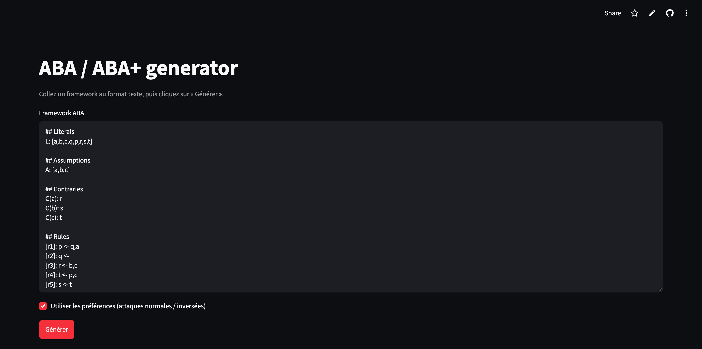
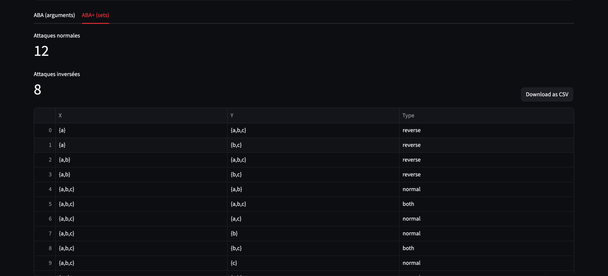
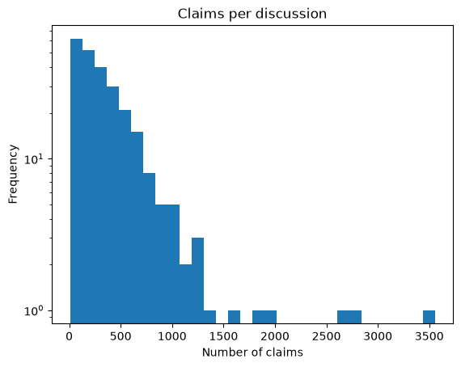
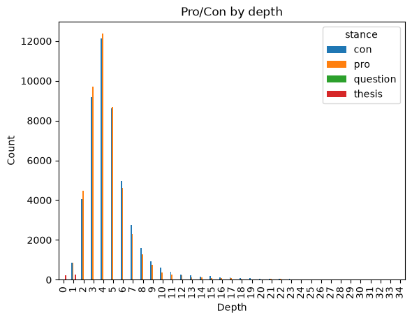
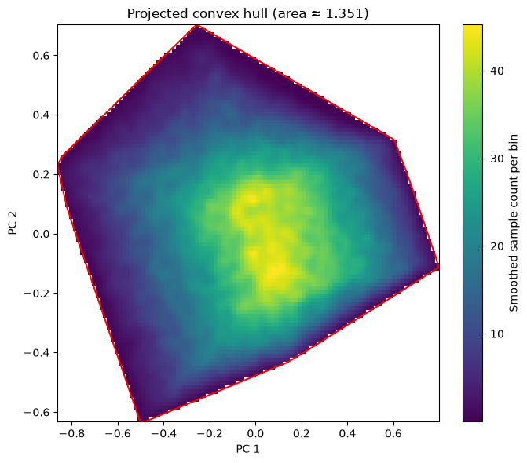

# Argumentation Theory Project Report

**Course:** Argumentation Theory and Applications  
**Group:** [group number]  
**Members:** BENBOUTA WALID, LAARIF RAYEN, RANDRIAMANANTENA ARO  
**Date:** [submission date]

## Abstract

This project implements an Assumption-Based Argumentation (ABA/ABA+) generator, builds and evaluates relation-classification and relation-discovery baselines on a snapshot of Kialo discussions, and visualizes acceptability-degree spaces for weighted h-categorizer semantics. The ABA generator parses frameworks, constructs arguments and attacks, handles preferences, and converts frameworks to non-circular and atomic forms. The Kialo pipeline parses 250 discussion exports into 94,707 claims and evaluates models using discussion-level data splits. The gradual-semantics experiment samples intrinsic weights, computes h-categorizer scores, and compares projected density maps across frameworks, sample sizes, and random seeds.

## 1. Reasoning with ABA and ABA+

### 1.1 Framework and implementation

An ABA framework comprises a language of literals, rules, assumptions, and a contrary for each assumption. A rule `h <- b1,b2` derives `h` when both body literals are available; an empty body denotes a fact. An argument is a claim together with the assumptions used in its derivation. An argument attacks another when its claim is the contrary of an assumption in the other argument's support.

The engine is implemented in `aba.py` as `ABAFramework`. It reads the assignment's text syntax, including `L:`, `A:`, `C(a):`, `[r1]: ...`, and `PREF:` declarations. It validates the framework, generates the finite core of support-claim pairs, and retains a derivation tree for display. The engine also provides:

- detection and conversion of frameworks with cycles in the rule dependency graph;
- a sensitive transformation to atomic frameworks, in which rule bodies contain assumptions only;
- preference closure and normal/reverse attack calculations;
- ABA+ attacks between sets of assumptions.

For the assignment's example, the engine produces 8 arguments and 10 argument-level attacks. The sensitive atomic framework has 13 assumptions, 5 rules, and 18 arguments. With `PREF: a > b`, the set-level ABA+ view contains 12 normal and 8 reverse attacks.

The Streamlit application is deployed at **[https://grp1projet.streamlit.app/](https://grp1projet.streamlit.app/)**. To reproduce the example, open the application, retain or paste the framework text, choose whether to apply preferences, and click **Générer**. The **ABA (arguments)** view shows arguments, derivation trees, and attacks; **ABA+ (sets)** shows attacks between assumption sets. The set-level computation is exponential and is limited to frameworks with at most 10 assumptions; its graph is displayed only for up to 4 assumptions.



*Figure 1. Input area of the deployed ABA application.*



*Figure 2. ABA+ view showing normal and reverse set attacks.*

The parser and transformations are tested against course examples, including cyclic conversions and preference-sensitive attacks. `test_aba.py` contains the targeted tests. One limitation is that cycle detection is syntactic: it detects cycles in the non-assumption dependency graph and may flag a cycle even when no argument can be derived through it. The implementation constructs arguments and attacks; it does not compute extensions.

### Transformation pipeline and TD4 validation

The conversion pipeline addresses two distinct structural properties. First, `to_non_circular()` breaks cycles among non-assumption literals by making bounded levels of each such literal. Atomic rules are copied to every level; other rules at a level read non-assumption premises from the preceding level. The final level retains the original literal names, and assumptions are not renamed. This construction is intended to preserve the relevant extension semantics while removing cyclic derivations. The implementation detects cycles syntactically in the dependency graph, which can conservatively flag cycles that cannot occur in an actual argument tree.

Second, `to_atomic()` implements the sensitive atomic transformation on a non-circular framework. For every non-assumption literal \(s\), it introduces assumptions \(s_d\) and \(s_{nd}\) with contraries \(s_{nd}\) and \(s\), respectively, and replaces non-assumption literals in rule bodies by their \(d\)-assumptions. Thus each transformed rule body consists only of assumptions. `prepare()` first flattens where necessary, then applies the non-circular and atomic conversions in order. The atomic framework is an equivalent representation for the intended extension-level reasoning; its arguments are not claimed to be identical to the original arguments.

The implementation was checked against the official TD4 correction and the stated course constructions. Tests check exact transformed rules and attack pairs in addition to totals:

| Case | Expected result | Verification |
|---|---|---|
| Exercise 1, original ABA | 8 arguments, 10 attacks | PASS |
| Exercise 1, sensitive atomic form | 13 assumptions, 5 rules, 18 arguments | PASS |
| Exercise 2, non-circular form | 12 rules, 10 arguments, 12 attacks | PASS |
| Exercise 2, atomic form | 20 assumptions, 12 rules, 32 arguments | PASS |
| Exercise 3, ABA+ | 12 normal and 8 reverse set attacks | PASS |

The atomic argument counts follow the project's course-based calculation; the transformation establishes extension correspondence, not equality of argument lists. Extension results quoted in the course correction are not presented as computations performed by this generator.

### 1.2 Reproduction

From the repository root, install the Part 1 dependencies and run the app:

```bash
python -m pip install -r requirements.txt
streamlit run app.py
```

Run the ABA tests with:

```bash
python -m pytest -q test_aba.py
```

## 2. Relation-based argument mining on Kialo

### 2.1 Data collection and exploration

The dataset is a snapshot of the 250 highest-ranked discussions returned by Kialo's listing endpoint on 17 October 2026. Discussion texts were obtained through Kialo's official exports, downloaded manually from an authenticated account. Automated crawling was not used: Kialo's `robots.txt` disallows crawling, and exports require authentication. The automated export helper in `part2_kialo.py` is retained but requires a caller-provided authenticated session. The raw data are not included in the public repository.

The parser in `part2_kialo.py` was adapted from the Kialo parser in [4mbroise/ADC](https://github.com/4mbroise/ADC). The adaptation supports multi-line claim text and localized stance labels, removes citation markers and internal “See” links, records external discussion links, skips the source list, and excludes Question-to-Thesis edges that do not express support or attack. The source repository has no licence; the parser's provenance and modifications are therefore stated explicitly here.

Parsing succeeded for all 250 discussions: each parsed claim count matches the count reported by the listing API, and no claim text is empty. The resulting corpus contains 94,707 claims and 94,199 labelled child-parent pairs:

| Label | Pairs | Share |
|---|---:|---:|
| Support (Pro) | 46,557 | 49.4% |
| Attack (Con) | 47,642 | 50.6% |

The collection has 239 English discussions; the remainder are in other or unspecified languages. Discussion sizes are highly skewed (median 272.5 claims, mean 378.8, maximum 3,554). The median maximum discussion depth is 7, and one discussion reaches depth 34. Claims are short (median 22 words; 95th percentile 50 words). The proportion of Con claims rises in deeper levels, reaching 61.7% at depth 10 or greater. This is consistent with deeper discussion threads containing more rebuttals, although depth alone is only a weak indicator of stance.

The 250 highest-ranked discussions are a selected, dated sample and should not be treated as representative of all Kialo discussions. Pro and Con labels are user-assigned and describe each claim's relation to its parent.



*Figure 3. Claim counts by discussion, on a logarithmic frequency scale.*



*Figure 4. Pro and Con claims by depth; question-root theses are treated separately.*

### 2.2 Relation classification and discovery

Two tasks are evaluated:

1. **Classification:** predict whether a linked child-parent pair is support or attack.
2. **Discovery:** identify whether a candidate pair is linked and rank possible parents for a claim.

To reduce topic leakage, whole discussions—not individual claim pairs—are assigned to train, validation, and test sets using a 70/15/15 split with seed 42. Repeated claim texts shared between training and test are filtered. Discovery negatives are generated separately within each split and at three difficulty levels: cross-discussion, same-discussion, and local structural negatives. These controls matter: generating negatives before splitting allowed test claims to leak into training and substantially reduced the usable test set.

The classification baselines are a majority-class predictor, word 1–2-gram TF-IDF with balanced logistic regression (B1), and a frozen `all-MiniLM-L6-v2` Sentence-BERT encoder with logistic regression over paired embedding features (B2). Discovery uses lexical pair-interaction features (D1), and a D2 variant adds lexical context from the candidate's parent.

**Classification results on the held-out debates** (macro-F1 is the primary metric):

| Model | Accuracy | Macro-F1 | F1 support | F1 attack | ROC-AUC | PR-AUC |
|---|---:|---:|---:|---:|---:|---:|
| Majority (attack) | 0.504 | 0.335 | 0.000 | 0.670 | — | — |
| B1: TF-IDF + logistic regression | 0.624 | 0.624 | 0.619 | 0.628 | 0.667 | 0.636 |
| B2: Sentence-BERT + logistic regression | **0.649** | **0.649** | **0.650** | **0.649** | **0.709** | **0.688** |

B2 improves macro-F1 by 2.6 percentage points over B1, but both models remain modest baselines. They encode the child and parent separately rather than learning their relation jointly.

**Discovery results:**

| Task / model | Main results |
|---|---|
| Binary D1 | Macro-F1 0.691; linked F1 0.559; ROC-AUC 0.778; PR-AUC 0.525 |
| Ranking D1 | Hits@1 0.127; Hits@5 0.289; MRR 0.210 |
| Ranking D2 (with context) | Hits@1 0.125; Hits@5 0.262; MRR 0.196 |
| Random ranking expectation | Hits@1 0.0025; Hits@5 0.0127; MRR 0.0151 |

The binary task is imbalanced (one positive to three negatives), so accuracy is misleading: the always-negative predictor reaches 0.751 accuracy, compared with D1's 0.747. Macro-F1, linked-class F1, and PR-AUC show that D1 detects a meaningful signal. In ranking over an average of approximately 745 candidate parents per claim, D1's Hits@1 is about 50 times the random expectation, but the task remains difficult. Adding the lexical context in D2 does not improve ranking; sibling candidates can share parent context with the claim, which may make them spuriously attractive.

The classification results are below the 80–94% scores reported by larger or fine-tuned models in the literature. This is not a like-for-like benchmark: datasets, domains, splits, and model capacity differ. Our discussion-level split and duplicate-text filtering are deliberately strict, and the baselines are not tuned. Published results are therefore context, not a direct controlled comparison.

| Study | Data and protocol | Task / metric | Published result | Project result |
|---|---|---|---|---|
| Agarwal et al. (2022), GraphNLI | Kialo; 1,560 debates collected before 28 January 2020 | Support/attack; accuracy | Bag-of-words + logistic regression: 67.00%; Sentence-BERT: 79.86%; GraphNLI: 82.87% | B1 accuracy: 62.4%; B2 accuracy: 64.9% |
| Gorur et al. (2024) | Kialo 2022; 3 domains; LLMs prompted with 4 examples | Support F1 / attack F1 / macro-F1 | Llama 2 70B: 87/84/86%; Mixtral 8x7B: 85/82/84%; Mistral 7B: 83/83/83% | B2: 65/65/65% |
| Faugier et al. (2024) | Kialo 2024; 10 domains; fine-tuned Mistral 7B | Macro-F1 | 89.7–93.9% across reported settings | B2 macro-F1: 64.9% |
| Ruiz-Dolz et al. (2021) | US2016 and MM2012 (not Kialo); 4 relation classes including artificial “no relation” | Macro-F1 | RoBERTa-large: 0.70 on US2016; 0.61 on MM2012 | Discovery binary macro-F1: 0.691 (different task and 2 classes) |

These scores show that our simple, frozen or lexical baselines trail the stronger fine-tuned and prompted models. They should not be read as a controlled head-to-head comparison: the data snapshots, languages, domains, label definitions, split protocols, and tasks differ. In particular, Ruiz-Dolz et al. evaluate a four-class relation task on other corpora, so their scores do not directly benchmark either Kialo classification or our binary discovery setup. None of these cited works evaluates parent ranking on Kialo; for that task we report random-ranking expectations as the reference point.

Several factors plausibly contribute to the classification gap. We hold out entire discussions and remove repeated texts across train and test, preventing topic and text leakage; our B1 and B2 baselines do not jointly encode a child-parent pair; and we do not tune on the validation debates. A fine-tuned cross-encoder evaluated on the same debate-level split is the most direct next comparison. For discovery, retrieval followed by reranking with hard local negatives is a plausible extension.

### 2.3 Reproduction and data provenance

The collection/parser workflow is documented in `part2_1_kialo_collection.ipynb`; modelling and evaluation are in `part2_2_relations.ipynb`. Core functions are in `part2_kialo.py` and `part2_relations.py`. Install the analysis dependencies and run the relevant tests:

```bash
python -m pip install -r requirements-part2.txt
python -m pytest -q test_part2.py
```

The full relation-analysis notebook takes substantially longer than the unit tests because it creates discovery negatives and ranks candidates. The collection snapshot is not bundled with the public repository, so reproducing the full experiment requires access to the corresponding exports.

## 3. Visualizing acceptability-degree spaces

### 3.1 Weighted h-categorizer and sampling

For an argumentation framework \((A,R)\) and intrinsic weights \(w(a)\in[0,1]\), the weighted h-categorizer score is the fixed point of

\[
x(a)=\frac{w(a)}{1+\sum_{b\in Att(a)}x(b)}.
\]

In `part3.ipynb`, `sample_hc` fixes an ordering of the arguments, samples independent uniform weight vectors, and evaluates all argument scores in batches. The attack matrix is oriented so that its row-to-column product gives the total scores of the attackers of each argument. The implementation uses a damped fixed-point iteration and stops when the maximum change is below \(\epsilon=10^{-9}\), with an explicit maximum-iteration failure. The default sample count is 100,000.

### Weighted h-categorizer implementation (2 marks)

For a fixed weighted framework, define the update \(F_w(x)(a)=w(a)/(1+\sum_{b\in Att(a)}x(b))\). The `weighted_h_categorizer` function in `aba.py` computes scores by fixed-point iteration: it initializes scores from the supplied intrinsic weights, repeatedly applies \(F_w\), and stops once \(\max_{a\in A}|F_w(x)(a)-x(a)|\leq\epsilon\). It requires a finite \(\epsilon>0\), exactly one weight in \([0,1]\) for each argument, and attacks whose endpoints are known arguments. Its default tolerance is \(10^{-6}\).

The Part 3 sampler uses a damped update \(x_{k+1}=\frac12x_k+\frac12F_w(x_k)\) to improve numerical stability for cyclic frameworks. Damping does not change the fixed points: \(x=\frac12x+\frac12F_w(x)\) holds exactly if and only if \(x=F_w(x)\). For the cases checked against `weighted_h_categorizer`, the resulting score vectors differ by at most \(2\cdot10^{-9}\). The notebook's stopping tolerance is \(10^{-9}\); its damping changes the convergence path, not the semantics being approximated.

For one argument the notebook shows a one-dimensional density histogram. For two arguments it computes the hull in the original score coordinates. For more than two arguments it centers the score vectors and projects them onto the first two principal components (PCA); it then computes and plots the convex hull in this 2D projection. A binned, Gaussian-smoothed heat map is masked outside the projected hull. Thus, for frameworks with more than two arguments, the figure is a visualization of the projected space, not the full \(|A|\)-dimensional convex hull.



*Figure 5. Example three-argument framework: sampled score vectors projected onto the first two principal components, with projected convex hull and smoothed sample-density heat map.*

### 3.2 Resampling experiment

The experiment varies both framework structure and argument count: a mutual pair (2 arguments), the example framework (3), a chain (4), a star (5), and a directed cycle (6). For each framework, the notebook makes a 100,000-sample reference run (seed 0), fixes its PCA basis and heat-map grid, then compares independent runs at 5,000, 20,000, and 50,000 samples with seeds 1, 2, and 3. It reports total-variation distance (TV) between normalized smoothed heat maps and relative convex-hull area error against the reference hull.

| Framework | Arguments | Samples | Mean TV | TV SD | Mean hull-area error |
|---|---:|---:|---:|---:|---:|
| Mutual pair | 2 | 5,000 | 0.0602 | 0.0047 | 1.50% |
| Mutual pair | 2 | 20,000 | 0.0306 | 0.0007 | 0.44% |
| Mutual pair | 2 | 50,000 | 0.0216 | 0.0004 | 0.19% |
| Example framework | 3 | 5,000 | 0.0540 | 0.0007 | 6.75% |
| Example framework | 3 | 20,000 | 0.0311 | 0.0014 | 3.67% |
| Example framework | 3 | 50,000 | 0.0203 | 0.0007 | 2.08% |
| Chain | 4 | 5,000 | 0.0562 | 0.0020 | 9.82% |
| Chain | 4 | 20,000 | 0.0292 | 0.0005 | 4.83% |
| Chain | 4 | 50,000 | 0.0211 | 0.0003 | 2.16% |
| Star | 5 | 5,000 | 0.0514 | 0.0023 | 12.61% |
| Star | 5 | 20,000 | 0.0290 | 0.0008 | 5.63% |
| Star | 5 | 50,000 | 0.0207 | 0.0006 | 1.19% |
| Directed cycle | 6 | 5,000 | 0.0504 | 0.0009 | 19.63% |
| Directed cycle | 6 | 20,000 | 0.0263 | 0.0011 | 9.65% |
| Directed cycle | 6 | 50,000 | 0.0176 | 0.0012 | 4.94% |

### 3.3 Analysis

The heat-map estimates are **increasingly resilient to resampling as sample size grows**, in the tested cases. Mean TV distance falls from approximately 0.050–0.060 at 5,000 samples to 0.018–0.022 at 50,000 samples. This indicates that the broad density pattern is reproducible at the larger sample sizes, although local bin intensities still differ. The measured variation across three seeds is small in this experiment.

Convex-hull estimates are more sensitive than the smoothed density maps, especially for the cyclic framework: at 5,000 samples its mean hull-area error is 19.63%, falling to 4.94% at 50,000. The mutual pair converges faster by this measure, reaching 0.19% error at 50,000. This is expected for a boundary estimate: rare points near the extremes can change the hull even when the central density is already similar. More arguments and cyclic dependencies can also make the score-space boundary harder to cover with finite samples.

These conclusions are empirical rather than a proof of convergence. The reference map is itself a finite 100,000-sample estimate; only three resampling seeds are used; sample sizes in the comparison stop at 50,000; and frameworks range only from two to six arguments. The PCA basis is held fixed per framework to make the maps comparable, but it hides directions beyond the first two components. Consequently, the experiment supports the stability of the displayed 2D density pattern under the tested resampling conditions, not exact recovery of the full high-dimensional acceptance space.

To reproduce the experiment, run the cells in `part3.ipynb` in order. The notebook preserves the plotted output and the table above. The main function defaults to 100,000 samples and permits changing the framework, sample count, seed, tolerance, and grid resolution.

## 4. Overall conclusions

The ABA generator implements the required framework parsing, transformations, argument construction, and preference-aware attacks, with a public demonstration application. The Kialo pipeline produces a validated corpus and establishes leakage-aware baselines for relation classification and parent discovery; its results show useful signal but leave substantial room for stronger pair-aware models. The h-categorizer notebook implements the fixed-point semantics and visualizes sampled score spaces. Its resampling experiment indicates that projected heat maps become more stable as the number of samples increases, while convex-hull boundaries require more samples and remain less stable, particularly for the tested cycle.

## 5. References and source attribution

- P. M. Dung, “On the Acceptability of Arguments and Its Fundamental Role in Nonmonotonic Reasoning, Logic Programming and n-Person Games,” *Artificial Intelligence*, 77(2), 1995.
- P. M. Dung, R. A. Kowalski, and F. Toni, “Assumption-Based Argumentation,” in *Argumentation in Artificial Intelligence*, Springer, 2009.
- F. Toni, “A Tutorial on Assumption-Based Argumentation,” *Argument & Computation*, 5(1), 2014.
- K. Čyras and F. Toni, “ABA+: Assumption-Based Argumentation with Preferences,” KR, 2016.
- T. Lehtonen, A. Rapberger, M. Ulbricht, and J. P. Wallner, “Argumentation Frameworks Induced by Assumption-Based Argumentation: Relating Size and Complexity,” KR, 2023.
- Agarwal et al. (2022), GraphNLI, and Gorur et al. (2024) are cited for the Kialo relation-classification comparisons summarized in `PART2_REPORT.md`.
- Faugier et al. (2024), Kialo relation classification on ten domains with fine-tuned Mistral-7B, and Ruiz-Dolz et al. (2021), argument relation classification on US2016 and MM2012, are included in the comparison above; their scores are reported with the original metrics and dataset qualifications.
- The Kialo parser adaptation is based on [4mbroise/ADC](https://github.com/4mbroise/ADC); the repository has no licence. Adaptations to current exports are described in Section 2.1. No external implementation was copied into the ABA engine.
- B. Yun, INF2347M *Argumentation Theory and Applications*, Université Lyon 1, 2026: Lectures 4A and 4B, TD4 and its official correction.

## Submission note

Before submission, fill in the group number and submission date on the cover page and sign the separate contribution statement. Export this report to PDF and check the final page count against the 15-page limit. The notebooks should be submitted with their outputs preserved.
